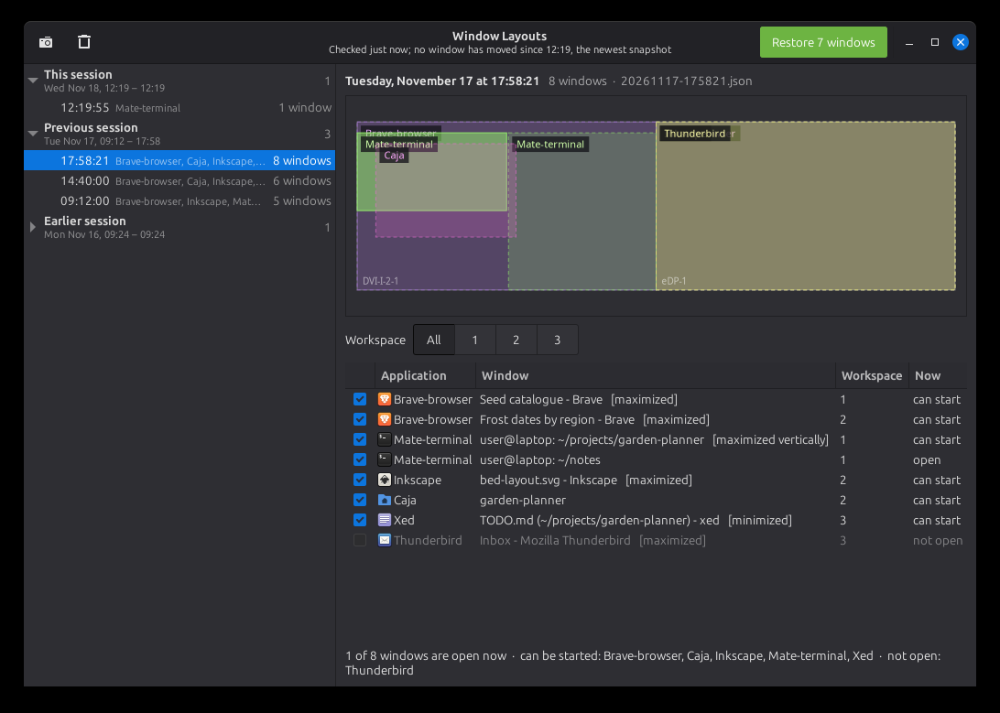

# window-layout

Records where every window on the desktop is, every two minutes, and puts
open windows back after a crash, a logout or a reboot.

Built 2026-10-27, after an out-of-memory thrash took the X session down and
a dozen windows' layout went with it. MATE's session autosave was off and
nothing else had written the layout down.

## Using it

After a crash or a reboot, log back in. Then do one of these (it starts
the apps that aren't open again, so you don't have to):

- **Double-click Window Layouts on the desktop** (it's also in the menu,
  under Accessories). That opens the picker.
- In the menu: **Restore Window Layout**. This starts what isn't open and
  puts every window back in one click, with no picker, and a notification
  says how it went.
- In a terminal: `window-layout restore --open`, or `window-layouts` for
  the picker.

### The picker



- **Left:** every snapshot on file, grouped by session: *This session*,
  *Previous session* (the one a crash or logout ended), then *Earlier
  session*. It opens with the previous session's last snapshot selected,
  which is the layout you lost.
- **Preview:** the chosen snapshot drawn to scale on the monitors it was
  taken on, each app in its own colour. Use **Workspace** to see one
  workspace at a time. Solid boxes are windows that are open now; dashed
  boxes are apps that aren't open. Select a row to outline that window.
- **List:** every window in the snapshot, all ticked. **Now** says which
  are *open* (they'll be moved) and which *can start* (not open, but
  Restore starts them first). Untick one to leave it alone. A window
  greyed out as *not open* recorded no command to start it with; open it
  yourself and it becomes tickable.
- **Restore N windows** starts the ticked windows that aren't open, waits
  for them, then moves every ticked window into place. The picker stays
  open, and the list updates every few seconds while it's open.
- The **camera button** saves the layout as it is right now, even if
  nothing has moved since the last snapshot.
- **Deleting:** select a snapshot and press the **trash button** or
  **Delete**, or right-click it. Select a session's heading to delete the
  whole session. An **Undo** bar appears at the bottom. Deleted snapshots
  can be brought back for a day (`window-layout undelete`), then they're
  gone for good. A deleted layout isn't saved again just because it is
  still on screen; the next snapshot comes when a window moves.
- **Under the title** it says when the desktop was last checked, e.g.
  *Checked just now; no window has moved since yesterday 23:03*. A
  snapshot is only saved when a window moves, so a newest snapshot from
  last night just means nothing has moved since. If the timer stops, this
  line says so. New snapshots appear while the picker is open.

Opening the picker a second time brings the open one to the front.

Windows that weren't open yet can be placed later: open them and restore
again. Running it twice is harmless, but with `--open` (or ticked *can
start* rows) a second run starts whatever still isn't open again.

```
window-layout restore            # the last layout of the session before this one
window-layout restore --dry-run  # say what would move, move nothing
window-layout restore --open     # start the apps that aren't open, then place all
window-layout restore latest     # the newest snapshot, this session included
window-layout restore 20261027-194300   # a particular snapshot
window-layout list               # sessions and their snapshots
window-layout snapshot -v        # take one now (if anything changed)
window-layout snapshot --force   # take one now, changed or not
window-layout delete 20261027-225125            # delete a snapshot
window-layout delete --session 20261027-225125  # ...or its whole session
window-layout undelete           # bring back what was deleted in the last day
```

## What it puts back

- Position and size
- Workspace (a window on all workspaces stays on all of them)
- Maximized, fullscreen, minimized, sticky, always-on-top and shaded states
- If a window was on a monitor that isn't connected now, it is moved onto
  the first monitor there is, and shrunk if it must be.

A window after a crash is a new X window, with a new id and often a new
title (a browser's title is its current tab). So saved windows are matched
to open ones of the same application (WM_CLASS), the closest title first,
and each window is used once. Saved windows that nothing matched are
listed with the command line that was running them.

## Starting what isn't open

Each snapshot records, for every window, its process's command line and
the folder it ran in. Restore in the picker, and `restore --open`, run it
again (detached, in that folder) and wait for the window:

- **One process, many windows.** A browser's windows all belong to one
  process. Its command runs once first, so a browser that restores its own
  session isn't opened twice; then whatever that didn't bring back is
  started once per window. That's how four terminals become four.
- **Terminals** (MATE, GNOME, Xfce, Tilix, Terminator) reopen in their
  folder, read from the default `user@host: ~/folder` title. What was
  running *in* a terminal (an editor, Claude Code) isn't started; you get a
  shell in that folder.
- **Apps that set no `_NET_WM_PID`** (xmessage), or a wrong one (Deskflow
  reports pid 2), are found by their WM_CLASS name instead, so their
  command is recorded too.
- **What can't start:** a window whose process wasn't readable (another
  user's), whose program is gone, or a relative command (`.venv/bin/python`)
  from a snapshot taken before folders were recorded. These stay *not
  open*.
- An app that brings up no window within 20 seconds isn't started a
  second time.

## How it works

- **The snapshot.** `window-layout-snapshot.timer` (a systemd user timer)
  runs `window-layout snapshot` every two minutes. That reads `wmctrl -lGpx`
  and `xprop`, skips panels and the desktop, and writes a JSON file to
  `~/.local/state/window-layout/snapshots/` only when the layout changed.
  A changed title alone doesn't count: a busy terminal's title has a
  spinner in it, and a browser's title is its current tab. Every run
  touches `snapshots/.checked`, saved or not, which is how the picker and
  `window-layout list` tell "unchanged" from "stopped". It
  exits quietly when there is no X display (during login, logout or a
  crash).
- **Sessions.** Each snapshot records its X session: the boot id plus the X
  server's pid and start time. `restore` defaults to the last snapshot of a
  session other than this one, which is the layout that was lost. Snapshots
  taken after you log back in can't hide it.
- **Pruning.** Snapshots are kept 14 days. The last snapshot of each of the
  five most recent sessions is kept regardless of age. Deleted snapshots
  wait in `snapshots/.deleted/` for a day, for undo, then are removed.
- **Deleted stays deleted.** `.checked` records the layout the last run
  saw, so a run that sees the same layout saves nothing, even if its
  snapshot was deleted in between.
- **Marco's offset.** Marco does not hand back the coordinates it was given:
  a window set to (300, 200) can report (312, 270), by an offset that varies
  from window to window. So `restore` moves each window, reads where it
  landed, and corrects once. The live tests check positions to the pixel.
- **Minimized windows.** Marco ignores `wmctrl -b remove,hidden`, so
  un-minimizing is done with `xdotool windowmap`. That doesn't focus the
  window or switch workspace.

Snapshots from before 2026-11-18 have the joined command line only, no
argv or folder; they still reopen when the command has no spaces inside
its arguments.

One limit: the newest snapshot can be up to two minutes older than the
crash. If the last snapshot of the old session caught a half-closed desktop
(for example, during a slow logout), `window-layout list` shows the earlier
ones, and `restore <name>` picks one.

## Files

| What | Where |
|---|---|
| The tool (stdlib Python, needs `wmctrl`, `xprop`, `xdotool`) | `window_layout.py`, symlinked as `~/.local/bin/window-layout` |
| The picker (GTK 3) | `window_layout_gui.py`, symlinked as `~/.local/bin/window-layouts` |
| Tests | `test_window_layout.py` and `test_window_layout_gui.py`, run with `python3 -m unittest -v` here. The live tests open xmessage windows on `$DISPLAY`, and the picker tests click the real Restore button. |
| Icon | `window-layout.svg`, linked into `~/.local/share/icons/hicolor/scalable/apps/` |
| Desktop icon | `~/Desktop/window-layouts.desktop`, executable and marked trusted, so Caja runs it without asking |
| Timer and service | `~/.config/systemd/user/window-layout-snapshot.{timer,service}` |
| Menu entries | `~/.local/share/applications/window-layouts.desktop` (picker), `window-layout-restore.desktop` (one-click restore) |
| Snapshots | `~/.local/state/window-layout/snapshots/` |

To check that it's running, `window-layout list` starts with when it last
checked, or:

```
systemctl --user list-timers window-layout-snapshot.timer
journalctl --user -u window-layout-snapshot
```

To remove it:

```
systemctl --user disable --now window-layout-snapshot.timer
```

Then delete the files in the table above, and the desktop icon.
